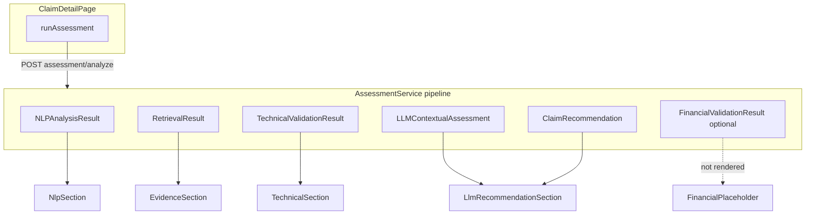

# Gate 4A — Frontend audit report (audit only)

**Date:** 2026-11-12  
**Scope:** Existing CLAIMWISE React frontend vs. backend Phases 2–6 APIs  
**Status:** Audit complete — **no frontend or backend source changes** in this gate  
**Supersedes (in part):** [backend/docs/phase7a_dashboard.md](../backend/docs/phase7a_dashboard.md) (auth and Phase 6 boundaries there are outdated)

---

## 1. Existing frontend architecture

### 1.1 Technology stack

| Layer | Choice |
|--------|--------|
| UI | React 18 |
| Build | Vite 5 |
| Language | TypeScript 5 |
| Styling | Tailwind CSS 3, custom theme tokens in `frontend/src/lib/theme.ts` |
| Routing | React Router 6 |
| Server state | TanStack React Query 5 |
| Icons | lucide-react |
| Tests | Vitest 2, Testing Library, jsdom |
| API types | Hand-maintained; optional `npm run generate-api-types` → `src/api/types/openapi.ts` (**not committed**) |

Entry: `frontend/src/main.tsx` — `QueryClientProvider` → `BrowserRouter` → `ThemeProvider` → `AuthProvider` → `AppRoutes`.

### 1.2 Folder structure (logical)

```
frontend/src/
  api/           # client.ts, endpoints.ts, services.ts, auth.ts, types/
  auth/          # JWT session, ProtectedRoute, AuthProvider
  components/    # App shell, header, ui primitives, theme
  features/      # assessment/, claims/, dealer/, financial/, reviewer-feedback/
  hooks/         # dealer stats, review queue count
  layouts/       # AppShell
  lib/           # format, statusLabels, nav, assessmentCache, apiConfig
  pages/         # route-level screens
  test/          # Vitest tests + fixtures
  data/          # sample new-claim form defaults
```

### 1.3 Routing and navigation

Defined in `frontend/src/routes.tsx`:

| Path | Page | Auth |
|------|------|------|
| `/login` | LoginPage | Public |
| `/` | DealerDashboardPage | Protected |
| `/claims` | ClaimsListPage | Protected |
| `/claims/new` | ClaimSubmitPage | Protected |
| `/claims/:claimId` | ClaimDetailPage (via ClaimDetailRoute) | Protected |
| `/settings` | SettingsPage | Protected |
| `/admin`, `/admin/users` | Admin dashboards | Protected |
| `/admin/organizations`, `/admin/audit` | SectionPlaceholderPage | Protected |

Nav sections: `frontend/src/lib/navConfig.ts` — My Claims, Review Queue (`/claims?status=under_review`).

**Not routed:** `ReviewerWorkspacePage.tsx`, legacy `DashboardPage.tsx` (only used in tests).

### 1.4 State and data fetching

- **Claims / assessment / feedback:** React Query (`useQuery`, `useMutation`) in pages.
- **Assessment KPIs on dashboard:** `sessionStorage` via `frontend/src/lib/assessmentCache.ts` (per-browser session only).
- **Auth token:** `authStore` + httpOnly refresh cookie; `apiFetch` attaches Bearer and retries once after refresh.

### 1.5 API client and authentication

- **`apiFetch`** (`frontend/src/api/client.ts`): JSON, 120s default timeout; assessment uses 300s in `runAssessment`.
- **Auth** (`frontend/src/api/auth.ts`): `POST /api/auth/login`, `/refresh`, `/logout`, `GET /api/auth/me`.
- **Business APIs** (`frontend/src/api/endpoints.ts` + `services.ts`):

| Client function | HTTP | Backend permission (when enforced) |
|-----------------|------|-------------------------------------|
| `listClaims` | `GET /api/v1/claims` | `claims:read` |
| `getClaim` | `GET /api/v1/claims/{id}` | `claims:read` |
| `getClaimProcessingStatus` | `GET /api/v1/claims/{id}/processing-status` | `claims:read` |
| `createClaim` | `POST /api/v1/claims` (multipart) | `claims:submit` |
| `runAssessment` | `POST /api/v1/assessment/analyze` | `claims:assess` |
| `listReviewerFeedback` / `submitReviewerFeedback` | `GET/POST /api/v1/reviewer-feedback…` | (see backend reviewer routes) |
| `fetchHealth` | `GET /health` | None |

**Not wrapped in frontend client:** `POST /nlp/analyze`, RAG routes, `POST /technical-validation/analyze`, `POST /recommendations/analyze`, `POST /financial-validation/*`, document download URL (declared on backend only).

### 1.6 Authorization in UI

- **Implemented:** `ProtectedRoute` redirects unauthenticated users to `/login`.
- **`hasPermission`** exists on `AuthContext` but is **not used** on pages (e.g. Run Assessment, New Claim, admin screens). Users may see actions that return **403** from API.

### 1.7 Loading, error, and empty states

- Shared: `LoadingState`, `ErrorState`, `EmptyState` in `frontend/src/components/ui/StateMessage.tsx`.
- Claim detail: loading/error for claim fetch; assessment errors (including 503 RAG hints); empty tabs when assessment not run.
- Claims list: loading/error; empty table when no matches.

### 1.8 Orphan / duplicate surfaces

| Artifact | Issue |
|----------|--------|
| `FinancialPlaceholder.tsx` vs `FinancialComparisonBars.tsx` | Bars component ready; placeholder used in Full assessment tab |
| `ReviewerWorkspacePage.tsx` | Duplicate intent of dealer dashboard; not in router |
| `DashboardPage.tsx` | Legacy; home is `DealerDashboardPage` |

---

## 2. Page and component inventory

### 2.1 Dashboards and lists

- **DealerDashboardPage:** welcome, help cards, links to new claim / claims list, `useDealerClaimStats` from `GET /claims`.
- **ClaimsListPage:** search, filters (status, category, client-side make), review queue mode, `ClaimsTable`.
- **AdminDashboardPage / AdminUsersPage / SettingsPage:** present; depth varies (admin APIs partially placeholder).

### 2.2 Claim submission

- **ClaimSubmitPage:** multipart submit via `createClaim`; file attachments; sample fill helper from `data/sampleNewClaim.ts`.

### 2.3 Claim detail (primary reviewer workspace)

**ClaimDetailPage** orchestrates:

| UI block | Component |
|----------|-----------|
| Toolbar | `ClaimInvestigationToolbar` — run assessment, open decision tab |
| Options | Auto ingest RAG, enable LLM (no financial toggle) |
| Summary | `ClaimSummaryCards` |
| Async pipeline | `ProcessingStatusPanel` |
| Tabs | AI analysis, Documents, History (placeholder), Related (placeholder), Full assessment, Decision |
| Side panel | `ClaimContextPanel` — status stepper, financial bars (predictions always null), attachments |
| Composer | `ClaimInvestigationComposer` (investigation messaging scaffold) |

### 2.4 Assessment feature components

| Phase | Component | Tab / location |
|-------|-----------|----------------|
| Overview | `OverviewSection` | Full assessment |
| NLP | `NlpSection` | Full assessment |
| RAG | `EvidenceSection` | Documents + Full assessment path via tabs |
| Technical | `TechnicalSection` | Full assessment; summary in `AiAnalysisWorkspace` |
| LLM + rules | `LlmRecommendationSection`, `AiAnalysisWorkspace` | Full / AI tab |
| Financial | `FinancialPlaceholder` | Full assessment |
| Decision | `ReviewerFeedbackPanel` | Decision tab |

### 2.5 Reusable UI

`Button`, `Badge`, `Card`, `Tabs` under `components/ui/`; theme toggle; `AppShell` + `AppHeader` + `UserAccountMenu`.

---

## 3. Backend-to-frontend integration map (Phases 2–6)

The production UI path is **single bundled assessment**: `POST /api/v1/assessment/analyze` → `ClaimAssessmentResponse`. Standalone phase endpoints exist but are not called from the UI.



### 3.1 Phase 2 — NLP

**Backend schema:** `NLPAnalysisResult` (`backend/app/modules/nlp/schemas.py`).

| Insight | Backend field(s) | Frontend |
|---------|------------------|----------|
| Normalized complaint/diagnosis/repair text | `original_*`, `normalized_*` | **IMPLEMENTED** — `NlpSection` |
| Entities by field | `field_extractions[]` | **IMPLEMENTED** — table by category |
| Symptoms, components, parts, DTCs, failure modes | `structured_extraction`, entity `category` | **PARTIAL** — generic grid; not grouped by `EntityCategory` |
| Diagnostic findings / relationships | `entity_relationships` | **IMPLEMENTED** — list with predicate |
| Repair actions / alignment hints | `repair_alignment_hints`, `recommended_repair` | **PARTIAL** — hints list; repair entity block not dedicated |
| Missing information | `missing_information` | **IMPLEMENTED** |
| Complaint–diagnosis hints | `complaint_diagnosis_comparison` (structured) | **NEEDS REFINEMENT** — raw `JSON.stringify` in UI |
| NLP debug metadata | `processing_metadata`, `llm_fallback` | **MISSING** — intentionally omitted (good for reviewers) |
| Standalone NLP API | `POST /api/v1/nlp/analyze` | **MISSING** — not used |

### 3.2 Phase 3 — RAG

**Backend schema:** `RetrievalResult`, `RetrievedPassage` (`backend/app/modules/rag/schemas.py`).

| Insight | Backend field(s) | Frontend |
|---------|------------------|----------|
| Retrieved passages | `retrieval.passages` | **IMPLEMENTED** — `EvidenceSection` |
| Titles, document IDs, types | `title`, `document_id`, `document_type` | **IMPLEMENTED** |
| Verification status | `verification_status` | **IMPLEMENTED** — badge |
| Relevance scores | `score`, `rank`, optional `rerank_score` | **PARTIAL** — score/rank; rerank not shown |
| Evidence scope / source type | `evidence_scope`, `evidence_source_type` | **MISSING** on passage cards |
| Applicability disclaimer | `note`, retrieval disclaimer copy | **PARTIAL** — history-only warning + footer copy |
| Parent context | `parent_text` | **MISSING** |
| Strategy / query | `strategy`, `query` | **MISSING** in UI (available on type) |
| Standalone RAG | `/rag/ingest`, `/search`, etc. | **MISSING** — only via assessment `auto_ingest` |

### 3.3 Phase 4 — Technical validation

**Backend schema:** `TechnicalValidationResult` (`backend/app/schemas/technical_validation.py`).

| Insight | Backend field(s) | Frontend |
|---------|------------------|----------|
| Overall technical status | `technical_status` | **IMPLEMENTED** — badges; not conflated with warranty approve/reject |
| Complaint–diagnosis consistency | `complaint_diagnosis_consistency` (enum) | **PARTIAL** — displayed as string |
| Diagnosis / repair narratives | `diagnosis_assessment`, `repair_justification`, summaries | **IMPLEMENTED** |
| Diagnostic evidence quality | `evidence_quality`, `confidence_level`, `confidence` | **PARTIAL** |
| Per-repair-operation justification | `repair_action_assessments[]` | **MISSING** |
| Structured findings | `validation_findings[]`, `missing_evidence_findings[]` | **MISSING** |
| Supporting / contradictory / contextual evidence | three evidence lists + `support_class` | **PARTIAL** — contradictory only; no supporting/contextual sections |
| Contradictions (legacy strings) | `missing_evidence[]` | **IMPLEMENTED** — string list only |
| Triggered rules / reasons | `triggered_rules`, `validation_reasons` | **PARTIAL** — rules only |
| Human review flag | `human_review_required` | **IMPLEMENTED** |
| Standalone TV API | `POST /technical-validation/analyze` | **MISSING** in client |

**Distinction from warranty decision:** `LlmRecommendationSection` labels Python rules as authoritative for workflow recommendation; technical status is not overwritten by LLM in UI (no override control).

### 3.4 Phase 5 — LLM recommendations

**Backend sources:**

- `llm_contextual_assessment` → `LLMContextualAssessment` / `LLMAssessmentResponse`
- `recommendation` → `ClaimRecommendation` (rules engine)
- Nested: `llm_structured`, `workflow_recommendation`, `repair_action_assessments` on recommendation

| Insight | Backend field(s) | Frontend |
|---------|------------------|----------|
| Technical interpretation (advisory) | `llm_contextual_assessment.assessment.summary`, symptom/diagnosis fields | **IMPLEMENTED** — subset |
| Evidence-grounded citations | `cited_evidence`, `recommendation.evidence_document_ids` | **MISSING** — IDs in rec only, no citation UI |
| Repair assessments linked to operations | `repair_interpretations`, `repair_action_assessments` | **MISSING** |
| Reviewer actions | `overall_recommendation`, reasons, `workflow_recommendation` | **PARTIAL** — overall + reasons; workflow object not shown |
| Limitations / uncertainty | `uncertainty_notes`, `limitations`, `contradictions_noted` | **PARTIAL** — uncertainty only |
| Disagreement / alignment | `suggested_alignment`, `respects_technical_validation` | **MISSING** |
| LLM execution metadata | `llm_execution` | **IMPLEMENTED** — status/provider/latency |
| Override Phase 4 | — | **Not implemented** (correct) |
| Hierarchy risk | — | **NEEDS REFINEMENT** — `AiAnalysisWorkspace` leads with LLM summary above TV card |

### 3.5 Phase 6 — Financial validation

**Backend sources:**

1. **Bundled:** `recommendation.financial_validation` (`FinancialValidationResult`) when assessment runs with financial step enabled (`financial_enabled` on request; server also gates on `FINANCIAL_ENABLED` / models).
2. **Standalone:** `POST /api/v1/financial-validation/analyze|predict`, `GET .../health`, `GET .../models` (org-scoped auth on mutating routes).

| Insight | Backend field(s) | Frontend |
|---------|------------------|----------|
| Submitted vs predicted parts/labour | `submitted_*`, `predicted_*` | **MISSING** — submitted only in placeholder/overview |
| Deviation % | `parts_discrepancy_pct`, `labour_discrepancy_pct` | **MISSING** |
| Financial status | `financial_status` | **MISSING** — only coarse `financial_assessment_status` string on recommendation |
| Algorithms / versions | `parts_model_algorithm`, `*_model_version` | **MISSING** |
| Experimental / synthetic | `experimental_prediction`, `synthetic_data_prediction`, `model_lifecycle`, `limitations` | **MISSING** |
| Human review | `human_review_required` | **MISSING** in financial UI |
| Rules triggered | `triggered_financial_rules`, `explanation` | **MISSING** |
| Client calls financial APIs | — | **MISSING** |
| Partial UI asset | `FinancialComparisonBars` | **PARTIAL** — wired with `null` predictions |

**Safety:** Copy in placeholder and AI workspace correctly states discrepancies do not auto-reject; must extend with **synthetic/experimental** banners when Gate 3 flags are true (backend fields exist).

---

## 4. Feature completion matrix

Classification: **IMPLEMENTED** | **PARTIAL** | **MISSING** | **NEEDS REFINEMENT**

| Feature | Status | Existing implementation | Missing work | Backend API / schema | Priority |
|---------|--------|-------------------------|--------------|---------------------|----------|
| Login / session | IMPLEMENTED | AuthProvider, LoginPage, refresh | Session expiry UX | `/api/auth/*` | P1 |
| Org-scoped claims list/detail | IMPLEMENTED | list/get claim via JWT | — | `GET /claims`, `GET /claims/{id}` | — |
| Claim multipart intake | IMPLEMENTED | ClaimSubmitPage | Permission gate UI | `POST /claims` | P1 |
| Processing status poll | PARTIAL | Poll while `PROCESSING` | Show TV/financial/rec stages | `GET .../processing-status` | P2 |
| Run bundled assessment | IMPLEMENTED | ClaimDetailPage mutation | `financial_enabled`, `retrieval_mode` | `POST /assessment/analyze` | **P0** |
| NLP reviewer insights | PARTIAL | NlpSection | Grouped categories; structured complaint–diagnosis UI | `nlp_analysis` on assessment | P1 |
| RAG evidence viewer | IMPLEMENTED | EvidenceSection | Passage metadata fields | `retrieval` on assessment | P2 |
| Technical validation detail | PARTIAL | TechnicalSection | Operations, findings, evidence lists | `technical_validation` | **P0** |
| LLM advisory display | PARTIAL | LlmRecommendationSection | Citations, repair interpretations, limitations | `llm_contextual_assessment`, `recommendation.llm_structured` | P1 |
| Python business recommendation | IMPLEMENTED | LlmRecommendationSection, AiAnalysisWorkspace | Label mapping for all enum values | `recommendation` | P1 |
| Financial validation UI | MISSING | Placeholder + null bars | Full `FinancialValidationResult` + disclaimers | assessment + `/financial-validation/*` | **P0** |
| Reviewer decision | IMPLEMENTED | ReviewerFeedbackPanel | History/audit tab | reviewer-feedback | P1 |
| Document download | MISSING | Attachments list UI | Link to `GET .../documents/{id}` | claims route | P2 |
| Dashboard KPIs | PARTIAL | sessionStorage cache | Server-side aggregates | N/A | P3 |
| Admin org/audit | MISSING | Placeholders | Phase 7B APIs | TBD | P3 |
| Permission-aware actions | PARTIAL | ProtectedRoute | `hasPermission` on buttons | JWT permissions | P1 |
| OpenAPI type sync | NEEDS REFINEMENT | Manual TS | Generate/commit or CI check | OpenAPI | P1 |
| Standalone phase endpoints | MISSING | — | Only if debugging/async UX | NLP/RAG/TV/financial routes | P3 |

### Reuse opportunities (do not duplicate)

- Extend **`FinancialComparisonBars`** + replace **`FinancialPlaceholder`** with one `FinancialValidationSection`.
- Expand **`TechnicalSection`** rather than new TV components.
- Keep **`EvidenceSection`**; add metadata rows to same cards.
- Use existing **`Badge`/`Card`/`statusLabels`** for financial and TV enums.

---

## 5. API and contract compatibility

### 5.1 Endpoint coverage

| Backend endpoint | Response model | Frontend method | TypeScript type | Match |
|------------------|----------------|-----------------|-----------------|-------|
| `GET /health` | health dict | `fetchHealth` | loose | OK |
| `GET /api/v1/claims` | `list[ClaimInput]` | `listClaims` | `ClaimInput[]` | OK |
| `GET /api/v1/claims/{id}` | `ClaimInput` | `getClaim` | `ClaimInput` | OK |
| `GET /api/v1/claims/{id}/processing-status` | `ProcessingStatus` | `getClaimProcessingStatus` | `ProcessingStatus` | OK (UI underuses fields) |
| `POST /api/v1/claims` | `ClaimInput` | `createClaim` | `ClaimInput` | OK |
| `GET /api/v1/claims/{id}/documents/{doc_id}` | stream | — | — | **MISSING** |
| `POST /api/v1/assessment/analyze` | `ClaimAssessmentResponse` | `runAssessment` | `ClaimAssessmentResponse` | **PARTIAL** (see §5.2) |
| `POST /api/v1/reviewer-feedback` | `ReviewerFeedback` | `submitReviewerFeedback` | `feedback.ts` | OK |
| `GET /api/v1/reviewer-feedback/{id}` | `list[ReviewerFeedback]` | `listReviewerFeedback` | OK | OK |
| `POST /api/v1/nlp/analyze` | `NLPAnalysisResult` | — | — | Not used |
| `POST /api/v1/rag/*` | RAG schemas | — | — | Not used |
| `POST /api/v1/technical-validation/analyze` | `TechnicalValidationResult` | — | — | Not used |
| `POST /api/v1/recommendations/analyze` | recommendation bundle | — | — | Not used |
| `GET /api/v1/financial-validation/health` | health dict | — | — | Not used |
| `GET /api/v1/financial-validation/models` | registry listing | — | — | Not used |
| `POST /api/v1/financial-validation/predict` | `FinancialPredictionResponse` | — | — | Not used |
| `POST /api/v1/financial-validation/analyze` | `FinancialValidationResult` | — | — | Not used |
| `GET /api/v1/rag/health`, `GET /api/v1/llm/health` | health | — | — | Constants in endpoints only |

### 5.2 Request body gaps — `AssessmentAnalyzeRequest`

| Field | Backend | Frontend `AssessmentAnalyzeRequest` |
|-------|---------|-------------------------------------|
| `claim_id` | required (xor claim) | sent |
| `claim` | optional body | not used |
| `top_k` | default 5 | sent (5) |
| `retrieval_mode` | optional enum | **not sent** |
| `auto_ingest` | bool | sent |
| `llm_enabled` | optional bool | sent |
| `financial_enabled` | optional bool | **not sent** |

### 5.3 Response schema field gaps

#### `ClaimAssessmentResponse`

| Field | Backend | Frontend `assessment.ts` |
|-------|---------|--------------------------|
| `nlp_analysis` | `NLPAnalysisResult` | `Record<string, unknown>` |
| `retrieval` | `RetrievalResult` | partial (`passages`, `note`, `query` optional) |
| `technical_validation` | full TV schema | slim interface |
| `llm_contextual_assessment` | `LLMContextualAssessment` | partial nested `assessment` |
| `recommendation` | `ClaimRecommendation` | missing `financial_validation`, `llm_structured`, `workflow_recommendation`, `repair_action_assessments`, `technical_validation` duplicate |
| `execution_metadata` | includes `rag_mode`, `generated_at`, enum financial status | subset; financial status as string |

#### `TechnicalValidationResult` (backend → frontend)

| Backend field | In frontend TS | Rendered in UI |
|---------------|----------------|----------------|
| `technical_status` | yes | yes |
| `explanation`, summaries | yes | yes |
| `supporting_evidence` | yes (type partial) | **no** |
| `contradictory_evidence` | yes | yes |
| `contextual_evidence` | no | no |
| `missing_evidence` | yes | yes |
| `missing_evidence_findings` | no | no |
| `validation_findings` | no | no |
| `repair_action_assessments` | no | no |
| `complaint_diagnosis_consistency` | optional string | yes (enum labels not mapped) |
| `pipeline_version`, `validation_id` | no | no |

#### `FinancialValidationResult` (backend → frontend)

| Backend field | Frontend |
|---------------|----------|
| All fields in `backend/app/schemas/financial_validation.py` | **No TS type; no UI** |

#### `FinancialPredictionResponse` (standalone predict)

Extended Gate 3 fields (`experimental_prediction`, `synthetic_data_prediction`, `inference_mode`, etc.) in `backend/app/modules/financial_validation/schemas/prediction.py` — **no frontend type**.

### 5.4 Enum / label mismatches

| Enum | Issue |
|------|--------|
| `OverallRecommendation` | Backend includes `REQUEST_FURTHER_DIAGNOSIS`, `REVIEW_REPAIR_SCOPE`, `REVIEW_CONTRADICTIONS`, `REQUEST_ADDITIONAL_EVIDENCE`; `statusLabels.ts` maps subset |
| `FinancialAssessmentStatus` | Backend enum `PENDING`/`AVAILABLE`/`UNAVAILABLE`; UI treats as free text |
| `FinancialStatus` | Not represented on frontend |
| `ConsistencyLevel`, `RepairJustificationStatus` | Not represented on frontend |

### 5.5 Unavailable backend functionality (for UI)

- No **server-side dashboard aggregates** (counts by recommendation/financial flag) — dashboard uses list + session cache.
- No **claim history / audit API** wired (History tab placeholder).
- No **related claims by VIN** API (Related tab placeholder).
- **Experimental financial models** require server env `FINANCIAL_EXPERIMENTAL_MODELS_ENABLED`; UI cannot detect except via response fields once wired.

---

## 6. UI/UX — recommended reviewer workflow

Extend the **existing** claim detail layout (no second architecture). Visual language: current Tailwind tokens, `Card`, `Badge`, tab pattern.

1. **Claims overview** — Dealer dashboard + claims list + review queue filter (existing).
2. **Submission** — ClaimSubmitPage (existing); post-submit navigate to detail.
3. **Claim header** — Summary cards, vehicle/repair, attachments (existing).
4. **Investigation status** — Expand ProcessingStatusPanel to all stages; poll until `READY` (refine).
5. **Run assessment** — Keep toolbar; add **Include financial validation** checkbox → `financial_enabled`; disable if user lacks `claims:assess`.
6. **AI analysis tab (reorder)** — (a) Technical validation status + one-line explanation, (b) Financial summary with experimental/synthetic banner when applicable, (c) LLM advisory excerpt with “Advisory only” label, (d) Overall Python recommendation — never imply auto-approval.
7. **Documents tab** — Retrieved evidence (existing); add scope/source metadata.
8. **Full assessment tab** — NLP (refined) → expanded TV → LLM details → **FinancialValidationSection** (replace placeholder).
9. **Decision tab** — Reviewer feedback (existing); show system recommendation vs reviewer decision side-by-side.

**Optional (P2–P3):** Route `ReviewerWorkspacePage` or remove; refresh financial-only via standalone analyze without full re-assessment.

---

## 7. Testing audit

| Category | Present | Gap |
|----------|---------|-----|
| Component unit tests | `TechnicalSection.test.tsx` | NLP, Evidence, LLM, Financial, ClaimContextPanel |
| Page tests | `DashboardPage.test.tsx` (legacy page) | `ClaimDetailPage`, `ClaimsListPage`, `ClaimSubmitPage`, `LoginPage` |
| API client | `apiClient.test.ts` (basic) | 401 refresh, Bearer attachment, error parsing |
| Fixtures | `assessment-clm-002.min.json` | Omit Phase 4 extended fields, financial_validation, llm_structured |
| Contract tests | None | Snapshot or zod validation against fixture from real API |
| Auth / 403 | None | Unauthenticated redirect; missing permission on assess |
| E2E | None | Optional Playwright happy path: login → claim → assess |
| Financial / synthetic disclaimers | None | Assert banner when `synthetic_data_prediction` |

**Test infrastructure:** `frontend/src/test/setup.ts`, Vitest in `package.json`; no MSW layer.

---

## 8. Prioritized implementation plan

### P0 — Essential (complete validation workflow visibility)

1. Add `financial.ts` types mirroring `FinancialValidationResult` + prediction response.
2. Extend `assessment.ts` for TV, recommendation, and NLP shapes used in UI.
3. Pass `financial_enabled` from claim detail; surface `recommendation.financial_validation`.
4. Replace `FinancialPlaceholder` with `FinancialValidationSection` (bars, deviations, status, rules, **synthetic/experimental** callouts, `human_review_required`).
5. Wire `FinancialComparisonBars` from real prediction values.
6. Expand `TechnicalSection` for repair operations, findings, structured missing evidence, supporting/contextual evidence.

### P1 — Important

1. `LlmRecommendationSection`: cited evidence, repair interpretations, limitations; subordinate to TV status.
2. `NlpSection`: human-readable complaint–diagnosis comparison; grouped entity categories.
3. `statusLabels`: full recommendation and financial enums.
4. Permission gates via `hasPermission` for assess, submit, admin.
5. Remove stale “Phase 6 pending” copy in `OverviewSection`, `FinancialPlaceholder`, `OverviewSection` financial note.

### P2 — Nice to have

1. `ProcessingStatusPanel`: TV, financial, recommendation stages.
2. `EvidenceSection`: `evidence_scope`, `evidence_source_type`, `parent_text` collapse.
3. Document download links on attachments.
4. `AiAnalysisWorkspace` information hierarchy (TV before LLM).

### P3 — Optional

1. Commit OpenAPI-generated types; CI drift check.
2. Standalone financial/TV analyze for support engineers.
3. Wire or delete `ReviewerWorkspacePage` / `DashboardPage`.

---

## 9. Files expected to change (implementation gate — not this audit)

| Area | Files |
|------|--------|
| Types | `frontend/src/api/types/assessment.ts`, new `financial.ts`, optionally `nlp.ts` |
| API | `frontend/src/api/endpoints.ts`, `frontend/src/api/services.ts` |
| Pages | `frontend/src/pages/ClaimDetailPage.tsx` |
| Features | `features/financial/*`, `TechnicalSection.tsx`, `LlmRecommendationSection.tsx`, `NlpSection.tsx`, `OverviewSection.tsx`, `AiAnalysisWorkspace.tsx`, `ClaimContextPanel.tsx`, `ProcessingStatusPanel.tsx`, `EvidenceSection.tsx` |
| Lib | `frontend/src/lib/statusLabels.ts` |
| Tests | `frontend/src/test/*`, expanded fixtures |
| Docs | Link from `backend/docs/phase7a_dashboard.md` to this audit |

**Out of scope:** new SPA, duplicate API clients, backend rule/ML changes.

---

## 10. Risks and dependencies

| Risk | Mitigation |
|------|------------|
| Synthetic / experimental predictions misread as fact | Prominent banners using `synthetic_data_prediction`, `limitations`, `model_lifecycle` |
| Long assessment latency | Keep 300s timeout; progress indicator; processing-status poll |
| Type drift | OpenAPI generate in CI or manual checklist per gate |
| 403 on Run Assessment | Gate button with `claims:assess` |
| Financial not in cached assessment | Re-run with `financial_enabled` or call `/financial-validation/analyze` |
| Backend financial models off | UI shows `INSUFFICIENT_DATA` / `UNAVAILABLE` states clearly |
| LLM summary visually dominates TV | Reorder AI tab; keep advisory labeling |
| Phase 7A doc contradicts auth | Update cross-doc pointers after implementation |

---

## Appendix A — Backend routes reference (v1)

Prefix: `/api/v1` unless noted.

- Claims: `GET/POST /claims`, `GET /claims/{id}`, `GET /claims/{id}/processing-status`, `GET /claims/{id}/documents/{document_id}`
- Assessment: `POST /assessment/analyze`
- Technical validation: `POST /technical-validation/analyze`
- Recommendations: `POST /recommendations/analyze`
- Financial: `GET /financial-validation/health`, `GET /financial-validation/models`, `POST /financial-validation/predict`, `POST /financial-validation/analyze`
- NLP: `POST /nlp/analyze`
- RAG: `GET /rag/health`, `POST /rag/ingest`, `POST /rag/search`, `POST /rag/retrieve-for-claim`, `POST /rag/evaluate`
- LLM: `GET /llm/health`
- Reviewer feedback: `POST /reviewer-feedback`, `GET /reviewer-feedback/{claim_id}`
- Auth: `/api/auth/login`, `/refresh`, `/logout`, `/me`
- Health: `GET /health`

---

## Appendix B — Document control

| Version | Date | Notes |
|---------|------|--------|
| 1.0 | 2026-11-12 | Gate 4A audit-only deliverable |

**Next step:** Explicit approval required before any frontend implementation (Gate 4B+).
